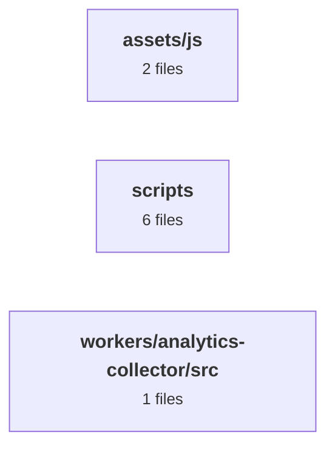

# CareerPage

이제훈(Jehun Lee) 포트폴리오 정적 사이트 — https://jehun-lee.work

- 요구사항·진행 상황: [docs/PRD.md](docs/PRD.md)
- 문서 지도: [docs/INDEX.md](docs/INDEX.md)
- 데이터 정본: `data/career/*.yaml` → `node scripts/yaml-to-json.js` → `data/portfolio.json`

<!-- AUTO:status (gen-status.py --readme) -->
### 구조 한눈에 (자동 생성 — 손으로 고치지 말 것)
> 모듈 3개 · 그룹 3개. 레벨별 그림(코드 구조·로직 구조)·현황: `docs/status.html`(로컬 생성) · 가이드 `agent-ops/docs/status-report-guide.md`

<!-- /AUTO:status -->
